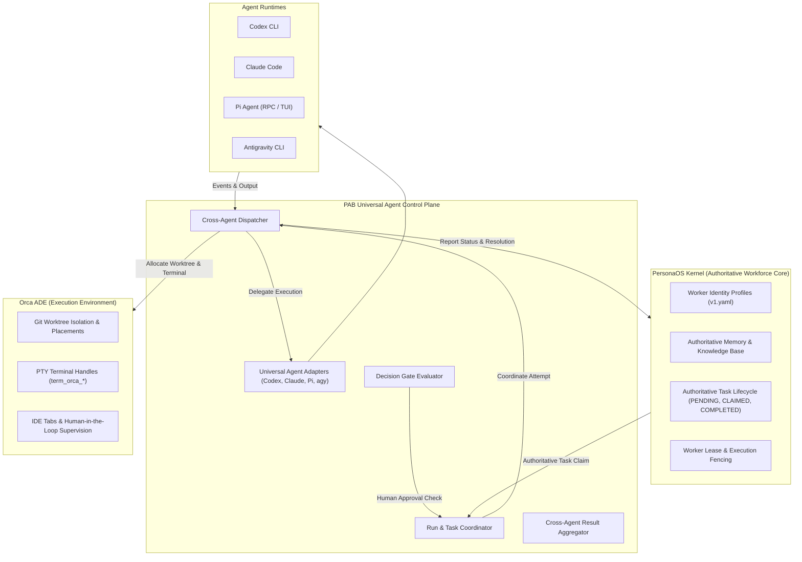
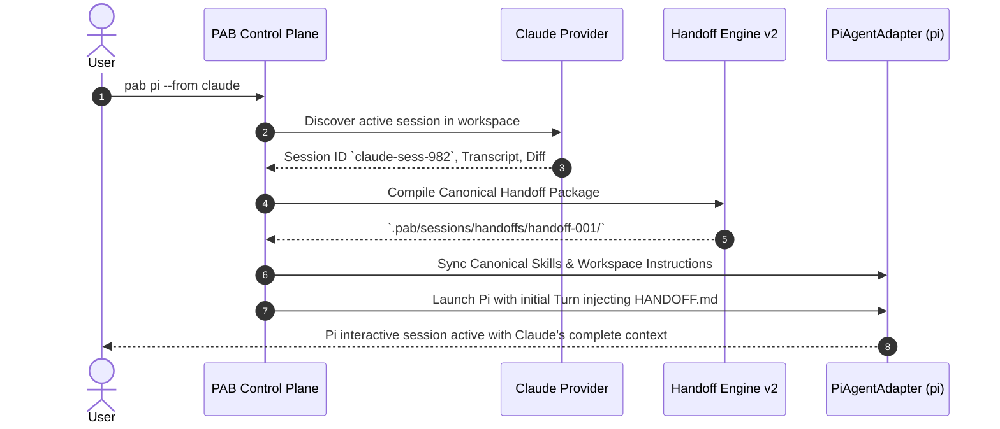
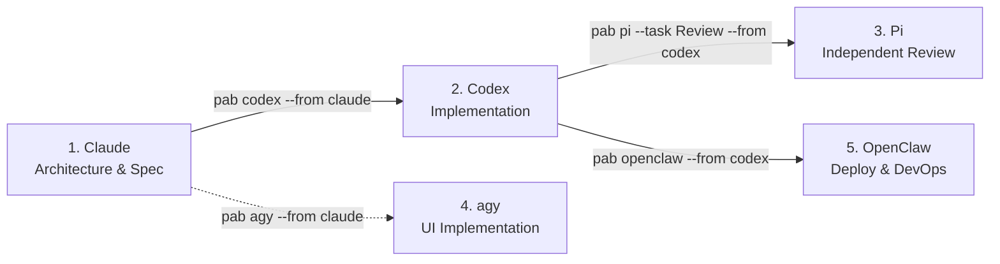
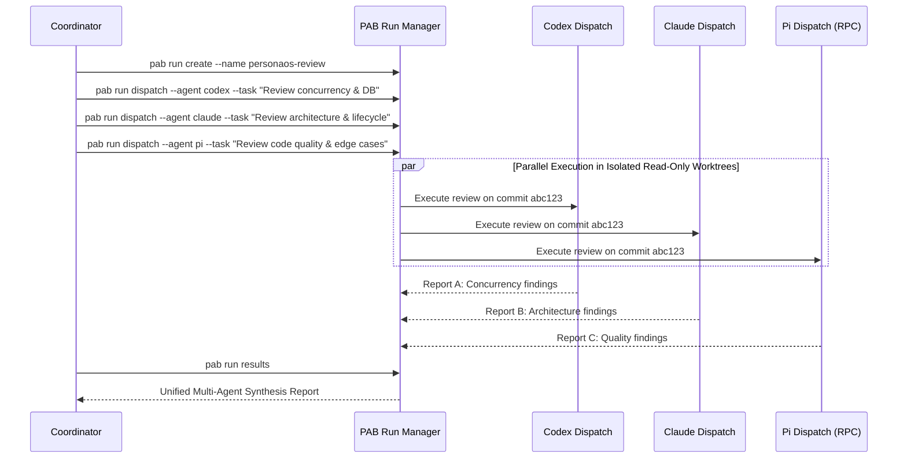

# PAB Orchestration Architecture Specification: Cross-Agent Universal Control Plane

## 1. Executive Summary

This document specifies the architectural evolution of the **PersonaOS Agent Bridge (PAB)** from a CLI launcher into a **Universal Agent Control Plane**. Drawing inspiration from the **Orca ADE Orchestration Engine**, PAB standardizes multi-agent coordination, lifecycle management, messaging, and decision gates across heterogeneous runtimes including **OpenAI Codex**, **Anthropic Claude Code**, **Google Antigravity (`agy`)**, **OpenClaw**, and **Pi Coding Agent (`pi`)**.

---

## 2. Architectural Boundaries & Responsibility Separation

To guarantee architectural integrity and prevent duplication of responsibilities, PAB enforces strict separation between three peer systems:



### 2.1 The Triad of Responsibilities

1. **PersonaOS Kernel (Authoritative Authority)**:
   - Owns Worker Identity (`v1.yaml`), persistent skills, and memory.
   - Maintains authoritative task lifecycle states: `PENDING`, `CLAIMED`, `RUNNING`, `COMPLETED`, `FAILED`.
   - **Non-Compete Rule**: PAB **never** implements an internal task queue or worker scheduler that competes with PersonaOS.

2. **Orca ADE (Execution Placement & Isolation)**:
   - Owns physical Git worktree allocation, branching, and workspace sandboxes.
   - Owns terminal virtualization, multiplexing, and IDE visualization.

3. **PAB Universal Control Plane (Agent Interoperability & Supervision)**:
   - Dispatches tasks to appropriate agent runtimes based on capabilities.
   - Provides standardized session handoffs, context transfer, and event normalizations.
   - Aggregates multi-agent outputs into unified synthesis reports.

---

## 3. Core Orchestration Abstractions

PAB adopts and formalizes Orca's core orchestration primitives:

```text
+--------------------------------------------------------------------------+
|                             ORCHESTRATION RUN                            |
|  - run_id: "run-20261101-personaos-review"                               |
|  - objective: "Comprehensive review of PersonaOS Step 11 implementation"  |
|  - status: ACTIVE | coordinator_mailbox: [ ... ]                         |
+--------------------------------------------------------------------------+
         |                                           |
         v                                           v
+-------------------------------+           +-------------------------------+
|             TASK A            |           |             TASK B            |
| - task_id: "task-db-safety"   |           | - task_id: "task-code-qual"   |
| - spec: Concurrency review    |           | - spec: Quality & failover    |
| - deps: []                    |           | - deps: ["task-db-safety"]    |
+-------------------------------+           +-------------------------------+
         |                                           |
         v                                           v
+-------------------------------+           +-------------------------------+
|           DISPATCH 1          |           |           DISPATCH 2          |
| - agent: codex                |           | - agent: pi (via RPC)         |
| - worker: personaos-dev       |           | - worker: personaos-qa        |
| - worktree: /worktrees/wt-1   |           | - worktree: /worktrees/wt-2   |
| - status: SETTLED             |           | - status: RUNNING             |
+-------------------------------+           +-------------------------------+
```

### 3.1 Entity Data Contracts

#### A. `OrchestrationRun`
Represents an overarching multi-agent workflow boundary:
```python
class OrchestrationRun(BaseModel):
    run_id: str                      # Unique identifier (e.g. "run-20261101-0815")
    name: str                        # Human-readable label
    objective: str                   # Top-level objective
    created_at: datetime             # UTC timestamp
    status: RunStatus                # ACTIVE, PAUSED, COMPLETED, FAILED
    workspace_path: Path             # Primary project root
    coordinator_agent: Optional[str] # Leading agent (e.g. "claude" or "human")
    metadata: Dict[str, Any]         # Tags, commit SHAs, references
```

#### B. `OrchestrationTask`
A discrete unit of work linked to a PersonaOS task:
```python
class OrchestrationTask(BaseModel):
    task_id: str                     # Task identifier (matches PersonaOS task ID)
    run_id: str                      # Owning Run ID
    title: str                       # Concise task label
    spec: str                        # Detailed instructions/prompt
    dependencies: List[str]          # IDs of tasks that must complete first (DAG)
    status: TaskStatus               # PENDING, DISPATCHED, BLOCKED, COMPLETED, FAILED
    assigned_worker_id: Optional[str]# PersonaOS worker profile ID
    gate_id: Optional[str]           # Blocking Decision Gate ID if gated
    created_at: datetime
```

#### C. `OrchestrationDispatch`
An execution attempt of a task assigned to a specific runtime adapter:
```python
class OrchestrationDispatch(BaseModel):
    dispatch_id: str                 # Unique dispatch ID (e.g. "disp-c7f8a9")
    task_id: str                     # Target task ID
    run_id: str                      # Owning Run ID
    agent_provider: str              # codex, claude, pi, agy, openclaw
    worker_id: str                   # PersonaOS worker ID
    worktree_path: Path              # Dedicated worktree directory
    terminal_handle: Optional[str]   # Orca terminal handle (if allocated)
    process_id: Optional[int]        # OS PID (for managed processes)
    status: DispatchStatus           # STARTING, RUNNING, SETTLED, COMPLETED, FAILED
    attempt_number: int              # Retry counter
    started_at: datetime
    completed_at: Optional[datetime]
    result_summary: Optional[str]
```

#### D. `DecisionGate`
An explicit checkpoint requiring coordinator or human approval before proceeding:
```python
class DecisionGate(BaseModel):
    gate_id: str                     # Gate identifier (e.g. "gate-01")
    task_id: str                     # Blocked task ID
    question: str                    # Decision prompt for the reviewer
    options: List[str]               # Permitted choices (e.g. ["approve", "reject"])
    status: GateStatus               # PENDING, RESOLVED, EXPIRED
    resolution: Optional[str]        # Chosen option
    resolved_by: Optional[str]       # "human" or agent ID
    resolved_at: Optional[datetime]
```

---

## 4. Multi-Agent Workflows & Use Cases

### 4.1 Use Case A: Context Handoff (Claude ➔ Pi)

A developer transitioning an active exploration session from Claude Code into Pi:

```bash
pab pi --from claude
```



### 4.2 Use Case B: Cross-Agent Pipeline (Spec ➔ Code ➔ Review ➔ UI ➔ Deploy)



Command Sequence:
```bash
# 1. Claude designs architecture and writes specification
pab claude --task "Design PersonaOS Step 11 feature specification"

# 2. Codex implements the backend logic using Claude's spec
pab codex --from claude

# 3. Pi conducts rigorous code review and failure scenario analysis
pab pi --task "Review implementation against spec" --from codex

# 4. Antigravity implements the frontend / IDE components
pab agy --task "Implement UI components" --from claude

# 5. OpenClaw handles staging deployment and container validation
pab openclaw --task "Deploy to staging" --from codex
```

### 4.3 Use Case C: Multi-Reviewer Fan-Out with Read-Only Sandboxing

Executing parallel independent reviews across Codex, Claude, and Pi against a single Git commit:



---

## 5. Orca Runtime Integration Strategy

### 5.1 Native Orca Agents vs. Non-Native Bridge

Orca ADE provides native terminal orchestration (`orca orchestration worker-start`) for a specific set of agents:
`claude`, `codex`, `cursor`, `antigravity`, `muse`.

**Pi is not currently in Orca's native agent registry.** PAB bridges this disparity transparently:

```text
+--------------------------------------------------------------------------+
|                        PAB RUN SUPERVISOR                                |
+--------------------------------------------------------------------------+
                         |                                 |
                         | If Agent in Orca Registry       | If Agent == "pi"
                         v                                 v
          +-------------------------------+ +------------------------------+
          |     Native Orca Dispatch      | |      PAB Pi Bridge           |
          |  orca orchestration           | |  1. Allocate Orca worktree   |
          |  worker-start --agent claude  | |  2. Spawn pi --mode rpc      |
          |                               | |  3. Bridge events to Run     |
          +-------------------------------+ +------------------------------+
                         |                                 |
                         +----------------+----------------+
                                          |
                                          v
                         +---------------------------------+
                         |     Orca Unified Run Mailbox    |
                         |   (Messages, Heartbeats, Done)  |
                         +---------------------------------+
```

### 5.2 Pi Bridge Implementation Details:
1. PAB requests Orca to prepare an isolated worktree via `orca-ide worktree create`.
2. PAB spawns `pi --mode rpc` targeting that worktree directory.
3. During execution, PAB monitors Pi's RPC stream. When Pi emits `agent_settled`:
   - PAB formats an Orca orchestration message:
     ```bash
     orca orchestration send --type worker_done --outcome succeeded \
       --subject "Task completed" --task-id <id> --dispatch-id <disp_id>
     ```
4. This ensures that Orca's coordinator receives standard notifications regardless of runtime differences.

---

## 6. Standardized PAB Orchestration CLI Interface

PAB upgrades `pab run` into a unified Typer sub-application:

| Command | Arguments / Flags | Description |
| :--- | :--- | :--- |
| `pab run create` | `--name <name> --objective <text> [--workspace <path>]` | Create a new orchestration Run scope. |
| `pab run list` | `[--status <status>]` | List active and historical runs. |
| `pab run dispatch` | `--run <id> --agent <agent> --task <text> [--worker <id>]` | Dispatch an execution attempt. |
| `pab run status` | `[--run <id>] [--dispatch <id>] [--json]` | Inspect active task/dispatch states. |
| `pab run send` | `--run <id> --subject <text> --body <text> [--to <target>]` | Send an inter-agent orchestration message. |
| `pab run inbox` | `[--run <id>] [--recipient <target>]` | Inspect message queues and worker updates. |
| `pab run gate create` | `--task <id> --question <text> [--options <json>]` | Create a blocking decision gate. |
| `pab run gate resolve`| `--gate <id> --choice <text>` | Resolve a pending decision gate. |
| `pab run results` | `[--run <id>] [--format md\|json]` | Synthesize all dispatch results into a unified report. |

*Backwards Compatibility Guarantee*: Existing commands such as `pab run <agent_id> --provider <p>` remain functional via alias redirects.
