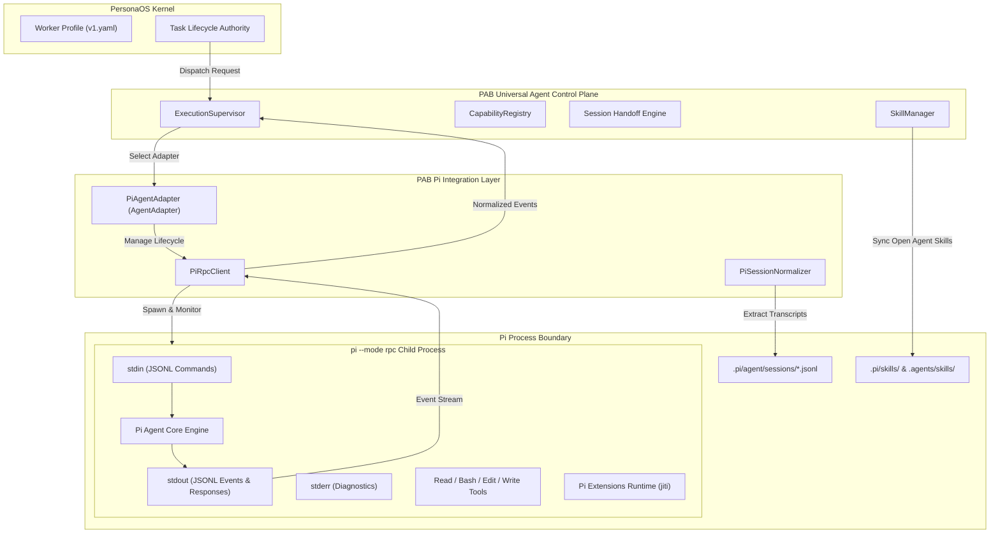
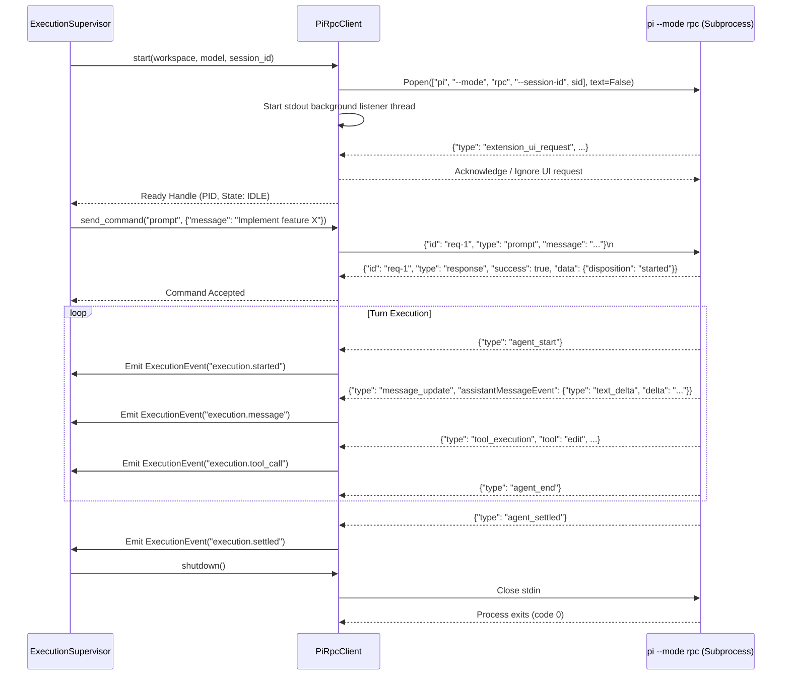

# PAB Pi Agent Integration Architecture Specification

## 1. Executive Summary

This specification establishes the architecture for integrating **Pi Coding Agent (`pi`)** as a first-class agent runtime within the **PersonaOS Agent Bridge (PAB)** universal control plane. 

Pi is an autonomous coding assistant capable of multi-turn code reasoning, file editing, shell command execution, and extensible tool calling. This architecture defines how PAB interacts with Pi in both **Interactive CLI mode** (for human-in-the-loop pair programming) and **Supervised RPC mode** (for automated execution, multi-agent orchestration, and context handoffs).

---

## 2. Architecture Overview

### 2.1 Component Interaction Diagram



### 2.2 Core Responsibilities & Boundaries

| Component | Primary Responsibility | Explicit Non-Responsibilities |
| :--- | :--- | :--- |
| **PersonaOS Kernel** | Owns authoritative worker identity, task leases, and task lifecycle. | Does not manage low-level OS processes or CLI flags. |
| **PAB Supervisor** | Supervises process lifecycles, event normalization, and idempotency fences. | Does not duplicate task queues or compete with PersonaOS scheduling. |
| **PiAgentAdapter** | Translates PAB canonical requests into native Pi configurations, commands, and RPC calls. | Does not modify Pi internal source code or bypass security boundaries. |
| **PiRpcClient** | Manages stdin/stdout binary framing, request-response correlation, and event dispatching. | Does not make policy decisions on task failures or retries. |
| **Pi Runtime** | Executes LLM turns, invokes built-in tools (read/edit/write/bash), and loads extensions. | Operates in its isolated child process sandbox. |

---

## 3. Detailed Component Architecture

### 3.1 `PiAgentAdapter` Specification

`PiAgentAdapter` inherits from `pab.providers.base.AgentAdapter` and implements the full runtime lifecycle contract:

```python
class PiAgentAdapter(AgentAdapter):
    """Universal runtime adapter for Pi Coding Agent."""

    def __init__(self, home_dir: Optional[Path] = None, workspace_root: Optional[Path] = None):
        self._home = home_dir or get_pi_home()
        self._workspace_root = workspace_root
        self._active_rpc_clients: Dict[str, PiRpcClient] = {}

    def discover(self) -> ProviderCapabilities: ...
    def capabilities(self) -> Dict[str, Any]: ...
    def launch(self, request: LaunchRequest) -> ExecutionHandle: ...
    def attach(self, execution_id: str) -> bool: ...
    def resume(self, session_id: str, context: Optional[Any] = None) -> ExecutionHandle: ...
    def prompt(self, execution_id: str, message: str, timeout: Optional[float] = None) -> Dict[str, Any]: ...
    def inspect(self, execution_id: str) -> ExecutionHandle: ...
    def stream_events(self, execution_id: str) -> Iterator[ExecutionEvent]: ...
    def send_input(self, execution_id: str, message: str) -> bool: ...
    def stop(self, execution_id: str, force: bool = False) -> bool: ...
    def list_sessions(self) -> List[Dict[str, Any]]: ...
    def export_session(self, session_id: str) -> Optional[NormalizedSession]: ...
    def resume_session(self, session_id: str) -> bool: ...
    def list_skills(self) -> List[Dict[str, Any]]: ...
    def install_skill(self, skill: CanonicalSkill) -> bool: ...
    def remove_skill(self, skill_id: str) -> bool: ...
```

#### Capability Declaration:
```python
def capabilities(self) -> Dict[str, Any]:
    return {
        "provider": "pi",
        "display_name": "Pi Coding Agent",
        "agent_management": True,
        "markdown_agents": True,
        "skills": True,
        "extensions": True,
        "memory": True,
        "sessions": True,
        "native_resume": True,
        "rpc_mode": True,
        "json_mode": True,
        "print_mode": True,
        "interactive_tui": True,
        "supported_models": ["anthropic/*", "openai/*", "gemini/*", "deepseek/*"],
        "instruction_files": ["AGENTS.md", "CLAUDE.md"],
    }
```

---

### 3.2 `PiRpcClient` Subprocess Protocol Engine

The `PiRpcClient` is responsible for low-level process management, protocol serialization, framing, and event routing.



#### Framing & Pipe Management Rules:
1. **Binary Stream Reading**: Standard library text-mode readers can split on Unicode line/paragraph separators (`U+2028`, `U+2029`), which are valid characters inside JSON strings. `PiRpcClient` reads stdout strictly as raw bytes and splits on LF (`\n` / `0x0A`), stripping trailing CR (`\r` / `0x0D`).
2. **Correlated Command Map**: Commands maintain thread-safe futures indexed by `id`. When a record arrives with `type == "response"`, the corresponding future is resolved with the payload data or rejected with `PiRpcError`.
3. **The Settle Contract**:
   - `agent_end` indicates the end of a single model/tool iteration.
   - `agent_before_settle` indicates pending continuation decisions.
   - **`agent_settled`** is the only authoritative signal that all automated turns, auto-compaction, and retries have completed. PAB supervisors must wait for `agent_settled` before reporting dispatch completion.

---

### 3.3 Event Translation Matrix

PAB maps Pi's native RPC events to standard PAB `ExecutionEvent` models:

| Pi Native RPC Record | PAB Canonical Event (`event_type`) | PAB Payload Contents |
| :--- | :--- | :--- |
| `{"type": "agent_start"}` | `execution.turn_started` | `{"turn_id": "...", "model": "..."}` |
| `{"type": "message_update", "assistantMessageEvent": {"type": "text_delta"}}` | `execution.message_delta` | `{"delta": text, "role": "assistant"}` |
| `{"type": "message_update", "assistantMessageEvent": {"type": "tool_call"}}` | `execution.tool_invoked` | `{"tool_name": name, "parameters": params}` |
| `{"type": "tool_execution"}` | `execution.tool_completed` | `{"tool_name": name, "output": output, "exit_code": code}` |
| `{"type": "compaction_start"}` | `execution.compaction_started` | `{"tokens_before": n}` |
| `{"type": "compaction_end"}` | `execution.compaction_ended` | `{"tokens_after": n}` |
| `{"type": "agent_end"}` | `execution.turn_completed` | `{"status": "turn_done"}` |
| `{"type": "agent_settled"}` | `execution.settled` | `{"final_status": "idle", "total_turns": n}` |
| `{"type": "extension_ui_request"}` | `execution.ui_interact` | Handled internally by `PiRpcClient` or logged |

---

## 4. Execution Modes & CLI Integration

PAB exposes Pi through four complementary execution pathways:

```text
+--------------------------------------------------------------------------+
|                               PAB CLI                                    |
|                                                                          |
|  pab pi                      --> Interactive TUI (Human pair programming)|
|  pab pi --from claude        --> Automated Context Handoff + Launch      |
|  pab run dispatch --agent pi --> Supervised RPC Subprocess (Background)  |
|  pab control launch -p pi    --> Machine-Readable Orchestration Control  |
+--------------------------------------------------------------------------+
                                     |
             +-----------------------+-----------------------+
             v                                               v
  [ Interactive Launch ]                          [ Supervised RPC ]
  - PTY Terminal                                  - Headless background
  - User keystrokes pass-through                  - JSONL over pipes
  - Full TUI rendering                            - Event streaming to PAB
```

### 4.1 CLI Parameter Mapping

| User Intent | PAB Command | Invocation Mapping |
| :--- | :--- | :--- |
| Interactive Session | `pab pi` | `pi` in current workspace |
| Migrate from Claude | `pab pi --from claude` | Handoff bundle created ➔ `pi -p "<handoff_instruction>"` |
| Continue Session | `pab pi --continue` | `pi -c` |
| Resume Specific ID | `pab pi --session <id>` | `pi --session <id>` |
| Supervised Task | `pab pi --task "<task>"` | `pi --mode rpc` supervised by `ExecutionSupervisor` |
| Orchestrated Dispatch| `pab run dispatch --agent pi` | Managed process via `PiAgentAdapter.launch()` |

---

## 5. Error Handling, Timeouts & Recovery

1. **Child Process Crash**:
   - If `pi` exits prematurely, the stdout reader captures the exit code, reads any remaining lines from stderr, and emits an `execution.failed` event with diagnostic details.
2. **Deadlock Prevention**:
   - Stderr is drained in an independent daemon thread to ensure that Pi's OS pipe buffer does not fill and deadlock stdout.
3. **Graceful Termination Sequence**:
   - **Phase 1**: Send `{"id": "...", "type": "abort"}` command over stdin.
   - **Phase 2**: Close stdin pipe.
   - **Phase 3**: Wait up to 5.0 seconds for clean exit.
   - **Phase 4**: Issue `SIGTERM` if process remains alive.
   - **Phase 5**: Issue `SIGKILL` after 2.0 additional seconds.
4. **Idempotency Guard**:
   - Every launch request passes through `ExecutionSupervisor`'s generation fence and SQLite idempotency verification (`idempotency_key`), preventing duplicate Pi worker spawns for the same task attempt.
