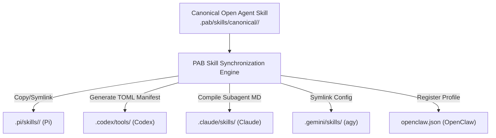

# PAB Skill & Extension Interoperability Specification

## 1. Executive Summary

This document specifies the **Skill and Extension Interoperability Architecture** for the **PersonaOS Agent Bridge (PAB)**, with focus on **Pi Coding Agent (`pi`)**. 

A core principle of PAB is cross-platform capability mobility: ensuring that domain skills (such as architectural runbooks, DevOps scripts, and security checklists) can be authored once and shared reliably across **OpenClaw**, **Google Antigravity (`agy`)**, **OpenAI Codex**, **Anthropic Claude Code**, and **Pi**.

---

## 2. Canonical Skill Standard: Open Agent Skills

PAB adopts the open standard **Open Agent Skills** (`SKILL.md`) as the single source of truth for all agent skills.

### 2.1 Directory Structure
```text
canonical-skill/
├── SKILL.md                 # Primary instruction file with YAML frontmatter
├── scripts/                 # Executable automation scripts (.sh, .py)
├── references/              # Detailed documentation, manuals, or schemas
└── assets/                  # Templates, data files, or configuration presets
```

### 2.2 Standard `SKILL.md` Schema
```markdown
---
name: pab-ops
description: Universal operational runbook and instructions for PersonaOS Agent Bridge (PAB). Use when deploying, migrating, or syncing agents.
version: 1.0.0
author: PersonaOS Core Team
compatibility: linux, darwin
metadata:
  tags: [orchestration, handoff, devops]
  allowed-tools: [read, bash, edit, write]
---

# PersonaOS Agent Bridge (PAB) Operational Skill

## Overview
Instructions and workflows for multi-agent management...
```

---

## 3. Pi Skill Architecture & Resolution Rules

Pi natively supports the Open Agent Skills specification with sophisticated progressive loading semantics.

### 3.1 Pi Discovery Locations
Pi scans skills in the following order of precedence:
1. **Project Local (`.pi/skills/`)**: `<workspace>/.pi/skills/<skill-name>/SKILL.md`
2. **Project Standard (`.agents/skills/`)**: `<workspace>/.agents/skills/<skill-name>/SKILL.md` (traverses parent directories up to repository root)
3. **User Global (`~/.pi/agent/skills/`)**: `~/.pi/agent/skills/<skill-name>/SKILL.md`
4. **User Standard (`~/.agents/skills/`)**: `~/.agents/skills/<skill-name>/SKILL.md`

### 3.2 Progressive Context Loading
Pi avoids context window bloat through a two-stage loading model:
1. **Startup Discovery**: Pi scans configured skill directories and extracts only the `name` and `description` frontmatter fields, injecting a compact skill index into the system prompt.
2. **Demand-Driven Activation**: When the LLM determines that a user's prompt matches a skill description, it autonomously invokes its `read` tool to load the full `SKILL.md` and related files. Alternatively, an operator can force immediate loading via `/skill:<name> <arguments>`.

---

## 4. Source Immutability & Conversion Rules

### 4.1 Strict Source Immutability Guarantee
When PAB synchronizes skills to Pi or any other provider:
- The canonical skill directory in `.pab/skills/canonical/<skill-name>/` is **strictly read-only**.
- PAB will **never mutate, format, or overwrite** source skill files during a deployment or synchronization operation.
- Synchronization is strictly idempotent: re-syncing a clean skill produces an exact byte-for-byte replica or symbolic link.

### 4.2 Cross-Platform Mapping Engine



---

## 5. Critical Distinction: Pi Skills vs. Pi Extensions

One of the most vital architectural boundaries in PAB is the **absolute separation of declarative Skills from executable Extensions**:

```text
+--------------------------------------------------------------------------+
|                               PI CAPABILITIES                            |
+--------------------------------------------------------------------------+
                    |                                      |
                    v                                      v
     [ Declarative Agent Skills ]            [ Executable TypeScript Extensions ]
     - File: SKILL.md                        - File: extension.ts (jiti loader)
     - Type: Markdown + YAML metadata        - Type: Executable Node.js code
     - Execution: LLM instructions          - Execution: Process-level runtime
     - Portability: 100% Portable (All)     - Portability: Pi runtime only
     - Security: Pure context prompt         - Security: Full OS process access
```

### 5.1 Why Extensions Cannot Be Managed as Skills
1. **Execution Boundary**: Extensions run arbitrary TypeScript code inside the host Node.js environment with complete operating-system permissions.
2. **Portability Failure**: Codex, Claude Code, and agy cannot execute Pi TypeScript extensions. Treating an extension as a portable skill would result in execution failures on non-Pi platforms.
3. **Security Hazard**: Silently migrating an untrusted extension across platforms poses a severe remote code execution vulnerability.

### 5.2 Extension Management Subsystem
PAB isolates extensions into a dedicated subsystem:
- Extensions reside in `.pi/extensions/` or `~/.pi/agent/extensions/`.
- PAB provides inspection commands (`pab agent inspect pi --extensions`) to list active extensions.
- Security verification: Before activating extensions in production, PAB can pass extension source files through AST security analysis (e.g., using `aegis-audit`) to detect unauthorized network egress, secret tampering, or filesystem breakout.

---

## 6. Skill CLI Operational Workflows

| Command | Purpose |
| :--- | :--- |
| `pab skill list` | List all canonical skills in the PAB registry. |
| `pab skill list --agent pi` | List skills discoverable by Pi across project and global paths. |
| `pab skill sync --agent pi` | Deploy canonical skills to `.pi/skills/` or `~/.pi/agent/skills/`. |
| `pab skill validate pi` | Validate that Pi skills adhere to frontmatter character limits (name ≤ 64 chars, description ≤ 1024 chars). |
| `pab skill convert <name> --to pi` | Convert an ad-hoc prompt into a standard Open Agent Skill for Pi. |
| `pab agent inspect pi` | Inspect Pi runtime configuration, active skills, and installed extensions. |
