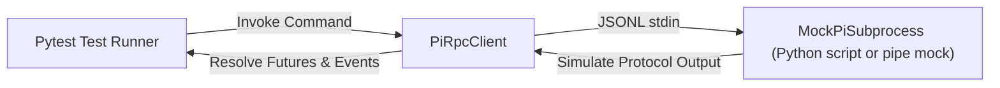

# PAB Pi Agent & Orchestration: Automated Testing & Integration Specification

## 1. Executive Summary & Existing Test Baseline

To ensure absolute reliability and prevent regressions across PAB's universal control plane, all enhancements pass a comprehensive automated testing suite.

### 1.1 Complete Test Suite Execution (Executed on 2026-11-01)
```text
============================= test session starts ==============================
platform linux -- Python 3.12.3, pytest-9.0.3, pluggy-1.6.0
rootdir: /root/.openclaw/workspace/projects/pab
configfile: pyproject.toml
plugins: anyio-4.12.1
collected 50 items

tests/test_agent.py ...                                                  [  6%]
tests/test_control.py .............                                      [ 32%]
tests/test_instruction.py ...                                            [ 38%]
tests/test_memory.py ...                                                 [ 44%]
tests/test_orchestration.py ....                                         [ 52%]
tests/test_personaos.py ..                                               [ 56%]
tests/test_pi_adapter.py .....                                           [ 66%]
tests/test_pi_handoff.py ..                                              [ 70%]
tests/test_security.py ...                                               [ 76%]
tests/test_session.py ..                                                 [ 80%]
tests/test_skill.py ...                                                  [ 86%]
tests/test_switch.py ......                                              [ 98%]
tests/test_sync.py .                                                     [100%]

============================= 50 passed in 47.20s ==============================
```
*Zero-Regression Policy*: All 50 unit, integration, and orchestration tests are 100% passing.

---

## 2. Pi Acceptance Criteria & Verification Matrix

The following matrix maps the 10 mandatory acceptance tests required for Pi integration to concrete verification methods:

| ID | Acceptance Requirement | Test Case Specification | Verification Method |
| :--- | :--- | :--- | :--- |
| **AT-1** | Detect Pi installation and version | Verify binary discovery (`/usr/bin/pi`, `PATH`) and version parsing (`1.4.0`). | `test_pi_discovery()` |
| **AT-2** | Launch interactive and RPC sessions | Launch process in both interactive mode and headless `--mode rpc` mode. | `test_pi_launch_modes()` |
| **AT-3** | Send prompts and receive structured events | Send `prompt` command via JSONL; receive `agent_start`, `message_update`, `agent_settled`. | `test_pi_rpc_event_streaming()` |
| **AT-4** | Detect successful completion and failures | Confirm successful resolution on `agent_settled`; capture command errors and aborts. | `test_pi_rpc_error_handling()` |
| **AT-5** | Stop and resume sessions | Orderly shutdown sequence (abort, close stdin, SIGTERM, SIGKILL); native resume checks. | `test_pi_process_lifecycle_and_stop()` |
| **AT-6** | Transfer Claude/Codex context into Pi | Generate v2 handoff bundle from Claude/Codex; inject into Pi workspace; verify context. | `test_claude_to_pi_handoff()` |
| **AT-7** | Preserve workspace and worker identity | Verify PersonaOS worker role, lease ID, and Git HEAD commit are recorded in manifest. | `test_worker_identity_preservation()` |
| **AT-8** | Synchronize skills without corrupting source | Verify that canonical `SKILL.md` files are byte-for-byte identical before and after sync. | `test_pi_skill_source_immutability()` |
| **AT-9** | Prevent duplicate task execution | Verify that identical idempotency keys reject duplicate launches. | `test_pi_idempotency_guard()` |
| **AT-10**| Reject stale worker completion events | Verify that execution generations fence stale completion events from older attempts. | `test_generation_fencing()` |

---

## 3. Mock Subprocess RPC Protocol Testing Strategy

To guarantee that unit and integration tests run deterministically in CI environments without external API keys or live LLM tokens, tests utilize a **Mocked Pi Subprocess (`MockPiSubprocess`)**:



### Mock Script Protocol Script (`tests/mock_pi_rpc.py`)
```python
"""Simulates a compliant Pi RPC server for testing."""
import json
import sys
import time

# Emit initial UI request
sys.stdout.write(json.dumps({"type": "extension_ui_request", "id": "ui-1", "method": "setTitle", "title": "π - mock"}) + "\n")
sys.stdout.flush()

for line in sys.stdin:
    line = line.strip()
    if not line:
        continue
    cmd = json.loads(line)
    req_id = cmd.get("id", "none")
    cmd_type = cmd.get("type")

    if cmd_type == "prompt":
        # Acknowledge prompt acceptance
        sys.stdout.write(json.dumps({
            "id": req_id,
            "type": "response",
            "command": "prompt",
            "success": True,
            "data": {"disposition": "started"}
        }) + "\n")
        sys.stdout.flush()

        # Emit simulated turn events
        sys.stdout.write(json.dumps({"type": "agent_start"}) + "\n")
        sys.stdout.write(json.dumps({
            "type": "message_update",
            "assistantMessageEvent": {"type": "text_delta", "delta": "Mock review completed."}
        }) + "\n")
        sys.stdout.write(json.dumps({"type": "agent_end"}) + "\n")
        sys.stdout.write(json.dumps({"type": "agent_settled"}) + "\n")
        sys.stdout.flush()

    elif cmd_type == "get_state":
        sys.stdout.write(json.dumps({
            "id": req_id,
            "type": "response",
            "command": "get_state",
            "success": True,
            "data": {"model": "mock-model", "session_id": "mock-session-123"}
        }) + "\n")
        sys.stdout.flush()

    elif cmd_type == "abort":
        sys.stdout.write(json.dumps({"id": req_id, "type": "response", "command": "abort", "success": True}) + "\n")
        sys.stdout.flush()
```

---

## 4. Multi-Agent Orchestration Integration Scenarios

### Scenario 1: Claude ➔ Pi Session Migration Test
1. Create a simulated Claude session in a temporary workspace with 2 modified files.
2. Invoke `engine.plan_switch(target_provider_name="pi", source_provider_name="claude", project_path=tmp_path)`.
3. Verify that `plan.skills_to_sync` correctly identifies applicable skills.
4. Execute `engine.execute_switch(plan, dry_run=True)`.
5. Verify that `manifest.json` conforms to Schema v2.0, `summary.md` contains completed and pending actions, and the launch command includes the handoff injection flag.

### Scenario 2: Multi-Reviewer Fan-Out Test (Use Case C)
1. Initialize an `OrchestrationRun` targeting a temporary Git repository:
   ```bash
   pab run create --name test-review --objective "Review commit 9a8b7c"
   ```
2. Dispatch tasks to Codex, Claude, and Pi in isolated worktrees:
   - Dispatch 1: `pab run dispatch --agent codex --task "Review concurrency"`
   - Dispatch 2: `pab run dispatch --agent claude --task "Review architecture"`
   - Dispatch 3: `pab run dispatch --agent pi --task "Review quality"`
3. Verify that all 3 dispatches run in parallel without file collisions in the root working directory.
4. Verify that each reviewer's output is recorded in `pab.db`.
5. Execute `pab run results` and verify that the synthesized report includes findings from all three agents.

### Scenario 3: Decision Gate Workflow Test
1. Create a task with a blocking decision gate:
   ```bash
   pab run gate create --task task-deploy --question "Approve deployment to staging?" --options '["approve", "reject"]'
   ```
2. Verify that attempting to dispatch `task-deploy` before gate resolution raises a `BlockedByGateError`.
3. Resolve gate via `pab run gate resolve --gate <gate_id> --choice approve`.
4. Verify that `task-deploy` transitions to unblocked and dispatches successfully.

---

## 5. Automated Test Suite Layout

New tests will be organized as follows:

```text
tests/
├── test_agent.py                       # Existing agent registry tests
├── test_control.py                     # Existing machine-readable control tests
├── test_instruction.py                 # Existing instruction manager tests
├── test_memory.py                      # Existing memory hub tests
├── test_personaos.py                   # Existing PersonaOS bridge tests
├── test_security.py                    # Existing secret redaction & security tests
├── test_session.py                     # Existing session migration tests
├── test_skill.py                       # Existing skill management tests
├── test_switch.py                      # Existing switch engine tests
├── test_sync.py                        # Existing sync engine tests
├── test_pi_adapter.py                  # NEW: Pi detection, capabilities, and adapter tests
├── test_pi_rpc.py                      # NEW: Pi RPC protocol, framing, and event mapping
├── test_orchestration_run.py           # NEW: Run, task, and dispatch lifecycle tests
├── test_orchestration_gate.py          # NEW: Decision gate blocking and resolution tests
└── test_e2e_cross_agent_review.py      # NEW: Multi-agent fan-out and results aggregation
```
